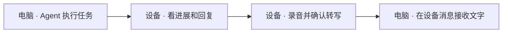
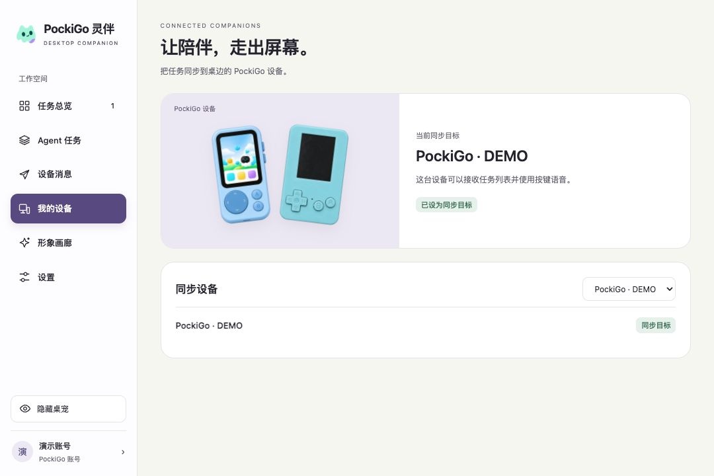
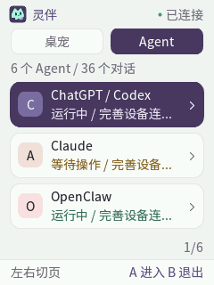
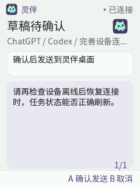
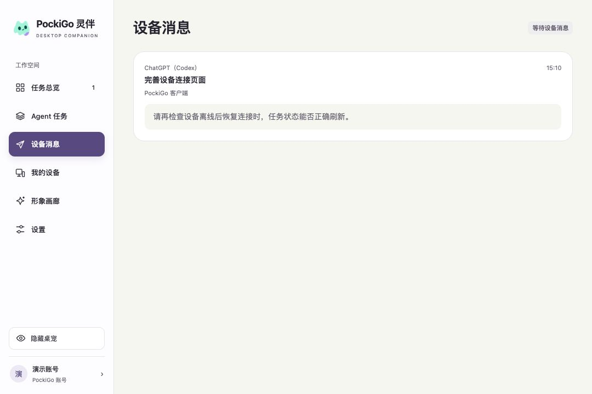

# PockiGo 灵伴使用说明

用 PockiGo Card 或 Open Game Box 查看电脑上的 Agent 任务、进展和回复摘要。在设备上录音并确认转写后，也可以把文字发到电脑上的「设备消息」。

## 电脑和设备怎么配合

例如，在电脑上让 Codex 跑一轮测试，离开工位时可以用设备查看任务是在运行、等待操作，还是已有结果。想到补充内容时，在设备上录一段话并确认转写，回到电脑后可以从「设备消息」取回这段文字，再决定是否发给 Agent。

下方截图使用桌面端演示数据和 PockiGo Card 模拟器，展示实际界面中的操作位置。

## 下载和安装桌面端

在 [GitHub Releases](https://github.com/wwwxutaibai/pockigo-downloads/releases) 打开所需版本，在 **Assets** 里选择安装包。

| 电脑 | 安装包 |
| --- | --- |
| Windows x64 或 ARM64 | Setup.exe |
| Mac Apple 芯片 | arm64.dmg |
| Mac Intel 芯片 | x64.dmg |

Mac 打开 DMG 后，将「PockiGo 灵伴」拖入「应用程序」。Windows 双击 Setup 安装包。手动升级前先退出正在运行的灵伴，再安装新版。

## 连接设备与电脑

1. 在电脑上启动 **PockiGo 灵伴**，进入「设置」登录 PockiGo。到系统浏览器完成授权，再返回桌面端。
2. 在绑定到同一 PockiGo 账号的设备上打开「灵伴」，并保持设备和电脑联网。
3. 回到电脑上的「我的设备」，选中要同步的设备。一次可同步一台设备。如果有多台设备，可根据设备名称末四位确认选择。
4. 在电脑上的「设置 → Agent 状态」开启已安装、想同步的 Agent。需要时根据界面提示重启对应的 Agent 客户端。

## 在设备上查看桌面任务

1. 在设备的桌宠首页按 **A** 进入 Agent 首页。也可以用左右键切换首页。
2. 用上下键选中 Agent，按 **A** 进入项目列表，再依次选择项目和对话。
3. 在对话详情页查看当前状态、进展或回复摘要。用上下键翻页，按 **B** 回到上一级。

通过桌面端「形象画廊」更换角色时，已选中的设备也会同步显示新形象。

## 从设备发送语音文字到电脑

1. 在设备的会话详情长按 **A** 录音，松开后等待转写。
2. 检查转写内容，按 **A** 确认发送，或按 **B** 退出预览。
3. 设备提示「已送达桌面」后，在电脑端打开「设备消息」，查看文字、来源会话和接收时间。如需把内容发送给 Agent，可在电脑上复制到对应会话。

| 在设备上确认转写 | 在桌面端查看收到的文字 |
| --- | --- |
|  |  |

## 设备没有出现，或没有任务

- **设备没有出现**。检查两边是否使用同一个 PockiGo 账号、设备是否已绑定，以及设备是否已打开「灵伴」。
- **设备有连接，列表没有任务**。在电脑上的「我的设备」确认已选中这台设备，再到「设置 → Agent 状态」确认已开启对应 Agent。
- **连接中断**。确认桌面端仍在运行、两边都联网，再返回「我的设备」检查同步目标。语音文字发送需要支持「设备消息」的桌面端和设备端版本。
